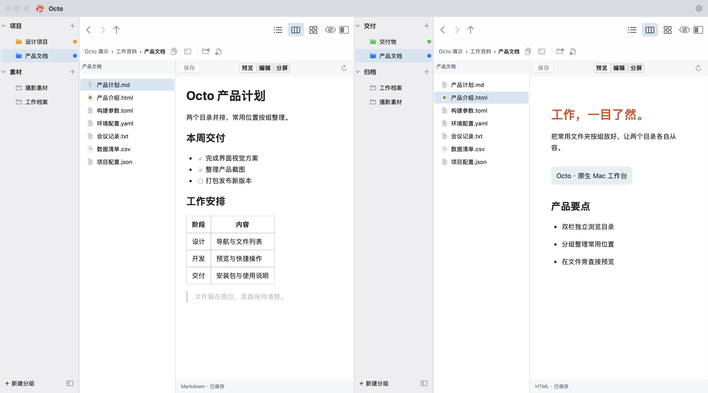
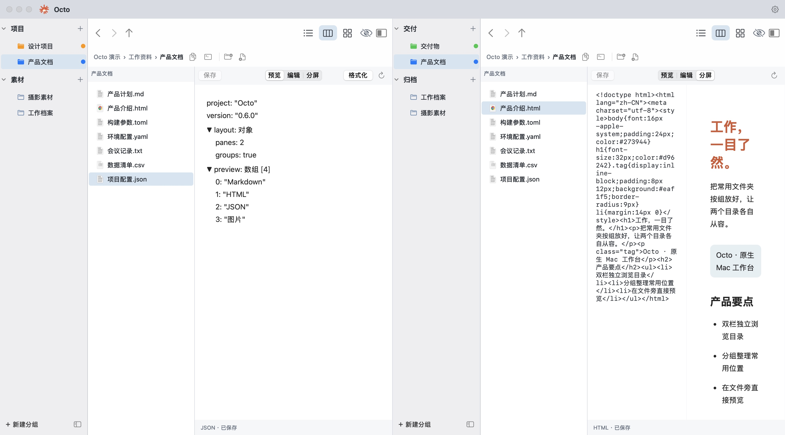
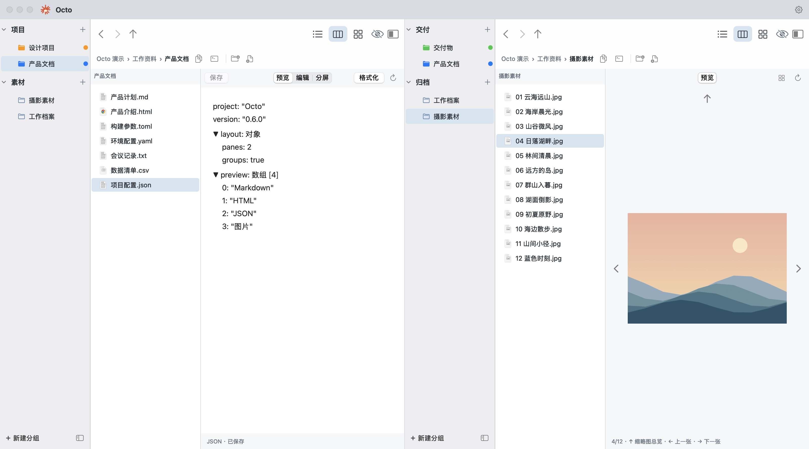
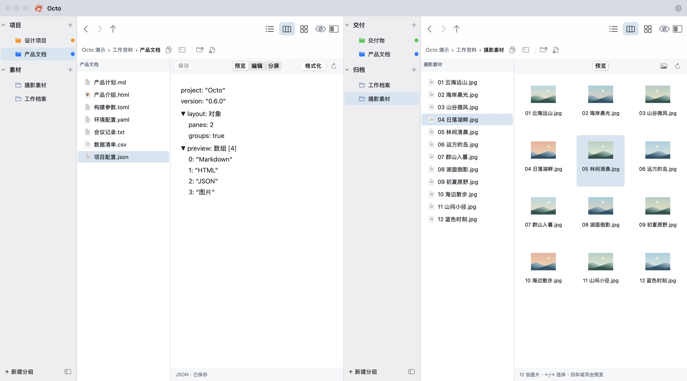

# Octo

**双栏分组，一目了然。** 为 macOS 原生构建的文件管理器，把来源和目标并排放好，在文件旁直接预览文档和浏览图片。

[产品介绍](https://octo.xiezhaoye.site/) · [下载 macOS 版](https://octo-dl.xiezhaoye.site/Octo-0.6.0-macos-arm64.zip) · [本次更新](https://github.com/xiezhaoye/octo/releases/tag/v0.6.0) · [问题反馈](https://github.com/xiezhaoye/octo/issues)

## 双栏 + 分组，高效处理文件

左右两栏各自浏览目录、切换视图和整理分组。把项目、素材、交付和归档设为常用入口，来源与目标同时可见，复制、移动和核对文件更直接。侧栏拖动整理的是入口配置；文件区拖动才操作真实文件。


## 文档直接预览，支持的格式写清楚

在分栏模式中选择文件，右侧直接显示内容。Markdown、HTML 和 JSON 支持预览、源码编辑及分屏；文本文件直接阅读和编辑。

| 使用方式 | 文件格式 |
| --- | --- |
| Markdown 渲染预览／编辑／分屏 | `.md`、`.markdown`、`.mdown`、`.mkd` |
| HTML 渲染预览／编辑／分屏 | `.html`、`.htm` |
| JSON 树形预览／编辑／分屏／格式化 | `.json` |
| 图片原生预览、上一张／下一张、缩略图总览 | PNG、JPEG／JPG、GIF、HEIC／HEIF、TIFF、BMP、WebP、ICO、AVIF、PSD，以及当前 macOS 解码器支持的其他图片与 RAW 格式 |
| 文本直接阅读与编辑 | `.txt`、`.text`、`.log`、`.csv`、`.yaml`、`.yml`、`.toml`、`.xml`、`.css`、`.js`、`.ts`、`.sh`、`.ini`、`.conf` |
| 系统快速预览 | 空格或右键“快速预览”调用 macOS Quick Look；其他格式的支持范围由系统及已安装扩展决定 |





<details>
<summary>展开本次截图环境可识别的图片扩展名</summary>

`.3fr`、`.arw`、`.astc`、`.atx`、`.avci`、`.avif`、`.axr`、`.bmp`、`.cr2`、`.cr3`、`.crw`、`.dcm`、`.dcr`、`.dds`、`.dib`、`.dicom`、`.dng`、`.dxo`、`.erf`、`.exr`、`.fff`、`.gif`、`.hdr`、`.heic`、`.heics`、`.heif`、`.hif`、`.icns`、`.ico`、`.iiq`、`.j2c`、`.j2k`、`.jp2`、`.jpe`、`.jpeg`、`.jpf`、`.jpg`、`.jpx`、`.jxl`、`.ktx`、`.ktx2`、`.mos`、`.mpo`、`.mrw`、`.nef`、`.nefx`、`.nrw`、`.orf`、`.ori`、`.pbm`、`.pct`、`.pef`、`.pfm`、`.pgm`、`.pic`、`.pict`、`.png`、`.ppm`、`.psd`、`.pvr`、`.raf`、`.raw`、`.rw2`、`.rwl`、`.sgi`、`.sr2`、`.srf`、`.srw`、`.tga`、`.tif`、`.tiff`、`.webp`

图片支持随 macOS 版本及解码器变化；上述列表按当前系统 ImageIO 识别能力整理。动画图片显示首帧，RAW 等格式的实际解码能力取决于系统。HTML 默认禁用脚本与外部资源；文本支持 UTF-8／UTF-16，最大 8 MB。当前提供源码编辑。

</details>

## 图片左右快看，一键回到缩略图

点击图片即可在文件旁查看，用 **←／→** 或图片外侧的箭头切换上一张、下一张；按 **↑** 或点击网格进入同目录缩略图总览，双击图片或按 **回车** 回到单张预览。





## 更多顺手的细节

- 原生毛玻璃侧栏和导航；浅色、深色、暖色与黑白四套外观。
- 列表、分栏、图标三种视图；目录底部留出可右键的空白，路径栏直接新建文件夹和文件。
- 七色文件夹标签独立保存于 Octo；选中后图标保持原色。
- 右键按用途分组，内置和自定义命令可拖动排序、跨组调整，支持按文件类型筛选。
- “打开方式”选择可用 App 或其他应用；“关于与更新”查看版本、检查更新、下载校验后安装重启。
- Swift + AppKit；无 Electron、第三方运行时、登录或应用内云同步。预览离线可用，检查更新时连接 Octo 下载服务。

## 安装

当前发布 **0.6.0（build 8）**，要求 **Apple Silicon、macOS 14 或更新版本**。解压 ZIP，将 Octo.app 拖到“应用程序”。目前为临时签名开发版，**未经过 Apple 公证**。若 macOS 阻止首次打开，可在尝试启动后，进入“系统设置 → 隐私与安全性”，使用系统提供的“仍要打开”。

文件访问依 macOS 授权，自定义 Shell 命令以当前用户权限执行。工作区保存在本机。在线更新先校验安装包，退出前检查未保存内容，并保留旧应用备份。功能边界见 [原生应用说明](NativeFileManager/README.md)。

## 从源码构建

需要 Xcode / Swift。下载包仅提供 arm64，未经验证的平台不在发布范围内。

```sh
cd NativeFileManager
zsh build.sh
open build/Octo.app
```

核心测试：`cd NativeFileManager && python3 check-build.py test`。落地页构建：`node landing/build.mjs`。

## 文档

[架构](架构.md) · [部署](部署.md) · [更新记录](CHANGELOG.md) · [待办](待办.md) · [交接](交接.md) · [产品需求](产品需求分析.md)

MIT License。以上均为真实应用界面截图，使用隔离目录中的演示文件与原创示意图片，不包含用户私人文件。
