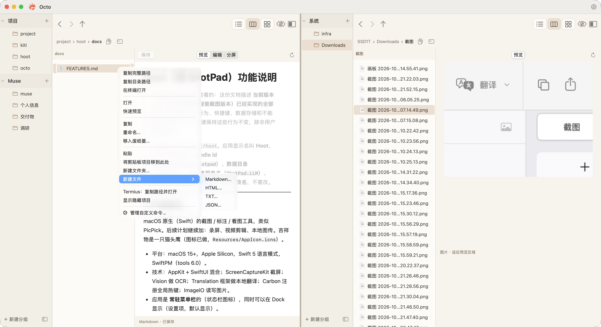

# Octo

为 macOS 原生构建的双屏文件管理器。独立浏览两个目录，用分组整理常用文件夹，在文件之间少些来回。

[产品介绍](https://octo.xiezhaoye.site/) · [下载 macOS 版](https://octo-dl.xiezhaoye.site/Octo-0.5.0-macos-arm64.zip) · [问题反馈](https://github.com/xiezhaoye/octo/issues)



## 功能

- 固定左右双屏，目录、分组与视图各自独立。任一屏可收起并通过竖条恢复。
- 常用文件夹按组整理，组和入口支持拖拽排序、跨屏移动；按 Option 复制的是入口配置，真实文件夹留在原位。
- 列表、分栏、图标三种视图一键切换；列表支持按名称、修改日期、大小排序。
- 拖拽复制与移动、同名冲突处理、Quick Look 预览、显示隐藏文件。
- 分栏内预览图片，预览和编辑 Markdown、HTML、TXT、JSON，右键新建文档；JSON 支持格式化和树形预览。
- 复制路径、打开终端和按文件类型筛选的自定义右键命令；四套皮肤在设置中切换。
- Swift + AppKit；无 Electron、第三方运行时、登录或应用内云同步。

## 安装

当前发布 **0.5.0**，要求 **Apple Silicon、macOS 14 或更新版本**。下载 ZIP 后解压，将 Octo.app 拖到“应用程序”。目前为本地临时签名开发版，**未经过 Apple 公证**。若 macOS 阻止首次打开，可在尝试启动后，进入“系统设置 → 隐私与安全性”，使用系统提供的“仍要打开”。

文件访问依 macOS 授权；自定义 Shell 命令以当前用户权限执行。工作区保存在本机，项目不提供远程存储服务。功能边界见 [原生应用说明](NativeFileManager/README.md)。

## 从源码构建

需要 Xcode / Swift。下载包目前仅提供 arm64；源码可自行尝试其他架构，未经验证的平台不在发布范围内。

```sh
cd NativeFileManager
zsh build.sh
open build/Octo.app
```

核心测试：`cd NativeFileManager && python3 check-build.py test`。
落地页构建：`node landing/build.mjs`，无需安装依赖。

## 文档

| 文档 | 内容 |
| --- | --- |
| [架构](架构.md) | 原生应用与发布结构 |
| [部署](部署.md) | 构建、发布、域名与回滚 |
| [错题本](错题本.md) | 已知陷阱及处理方法 |
| [待办](待办.md) | 尚未完成的事项 |
| [交接](交接.md) | 当前状态与接手入口 |
| [产品需求](产品需求分析.md) | 已确认的功能和后续规划 |

MIT License。产品截图为实际应用界面；首屏截图由维护者提供，其余来自隔离样例目录的原生窗口导出。
